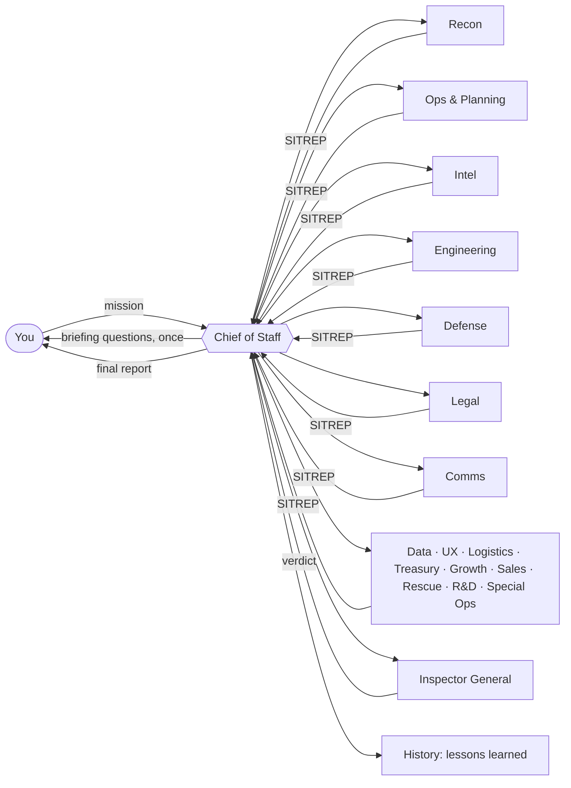

<div align="center">


# Omer Yehuda · Claude Code Plugins

**A curated marketplace of tested plugins for [Claude Code](https://code.claude.com).**

[](https://github.com/omer-yehuda/plugins/actions/workflows/validate.yml)
[](LICENSE)


**[Army command center (live)](https://omer-yehuda.github.io/plugins/)** · [Toon Shorts](https://omer-yehuda.github.io/plugins/toon-shorts/) · [Order of battle](https://omer-yehuda.github.io/plugins/#units)

</div>

---

## Quick start

Run this in Claude Code (v2.1.275 or later):

```
/plugin install army --marketplace omer-yehuda/plugins
/plugin install toon-shorts --marketplace omer-yehuda/plugins
/plugin install court --marketplace omer-yehuda/plugins
/plugin install customs --marketplace omer-yehuda/plugins
/plugin install er --marketplace omer-yehuda/plugins
/plugin install atc --marketplace omer-yehuda/plugins
/plugin install studio --marketplace omer-yehuda/plugins
/plugin install critics --marketplace omer-yehuda/plugins
/plugin install skill-installer --marketplace omer-yehuda/plugins
/plugin install mission-control --marketplace omer-yehuda/plugins
/plugin install academy --marketplace omer-yehuda/plugins
/plugin install archive --marketplace omer-yehuda/plugins
/plugin install newsroom --marketplace omer-yehuda/plugins
/plugin install premiere --marketplace omer-yehuda/plugins
/plugin install video-creator --marketplace omer-yehuda/plugins
```

Install only the ones you want.

<details>
<summary>Older Claude Code versions</summary>

```
/plugin marketplace add omer-yehuda/plugins
/plugin install army@omer-plugins
/plugin install toon-shorts@omer-plugins
/plugin install court@omer-plugins   # same pattern for customs, er, atc, studio, critics, skill-installer, mission-control, academy, archive, newsroom, premiere, video-creator
```
</details>

Restart Claude Code (or run `/reload-plugins`), then type:

```
raise the army build a landing page for my habit-tracking app
make me an animated short about the man who sold the Eiffel Tower
put it on trial: should we move from REST to GraphQL?
/customs:inspect https://github.com/<owner>/<repo>
admit this bug: checkout total is off by one cent
/atc:claim src/billing/** (invoice refactor)
studio, make a video about what a Claude skill is
let the critics taste it
install the pdf skill from anthropics/skills
mission control, are we go?
send this skill to the academy
ask the archive why we chose REST
newsroom, write the edition
premiere, make a film about the last lighthouse keeper
/video-creator:minecraft a village that rebuilds itself every morning
```

To update later, run `/plugin marketplace update omer-plugins`.

## Plugin catalog

| Plugin | What it does | Version |
|---|---|---|
| [**army**](plugins/army/README.md) | Multi-agent orchestration. A Chief of Staff commands 18 specialist units (intel, engineering, defense, legal, comms, data, sales and more) as subagents, backed by 110 on-demand field manuals. Session-bound safety gates, least-privilege tool kits, cost-aware model routing and local lessons-learned memory. | 1.2.0 |
| [**toon-shorts**](plugins/toon-shorts/README.md) | Animated short creator. Turns a true story into an original voiced, captioned 1080x1920 cartoon MP4 for Shorts, TikTok and Reels: 10 ideas, retention script, free AI voice or your own, toon characters on parallax sets, karaoke captions with Hebrew RTL, and a preview Claude reviews before rendering. | 1.0.1 |
| [**court**](plugins/court/README.md) | Code Court. Puts a technical decision on trial: opposing counsel argue each option from shared evidence, one rebuttal round, and a judge who never saw your opinion rules, with a dissent and the conditions that would overturn the verdict. | 1.0.0 |
| [**customs**](plugins/customs/README.md) | Border control for skills and plugins. Scans a local folder, GitHub repo or installed plugin before you trust it (remote code, obfuscation, hidden Unicode, prompt injection, credential access, exfiltration, wildcard hooks) and stamps a passport: CLEARED, SECONDARY INSPECTION or DENIED. A first filter, not a guarantee. | 1.0.0 |
| [**er**](plugins/er/README.md) | Bug ER. A triage nurse, attending, surgeon and discharge check fix a bug with a regression test first and the smallest possible incision, under a hard budget (default 3 files, 40 lines). | 1.0.0 |
| [**atc**](plugins/atc/README.md) | ATC: air traffic control for parallel Claude sessions. Sessions claim lanes (file globs), a hook asks before one session edits another's lane, and `/atc:clear` splits a big task across non-overlapping parallel pilots in worktrees. | 1.0.0 |
| [**studio**](plugins/studio/README.md) | An AI film crew. Writer, director, test-screening critic and editor turn a topic into a vertical or wide kinetic-typography explainer MP4 with captions, optional free local AI narration and upload metadata. The trend desk films a trending tool from real screenshots and makes a wide video plus a Short. Rendered locally with Pillow and ffmpeg. | 1.1.0 |
| [**critics**](plugins/critics/README.md) | The Critics' Table. Three independent critics (presentation, kitchen, recipe) taste your work, a head critic awards up to 3 stars with a short fix-before-serving list, and a re-taste shows the stars go up. | 1.0.0 |
| [**skill-installer**](plugins/skill-installer/README.md) | Skill Installer. Browse a skills repo or a plugin marketplace and install a skill from GitHub into `~/.claude/skills` or the project: dry run, quick risk check, atomic copy, backup on update, "did you mean" for typos. Adapted from OpenAI's Apache-2.0 Codex skill-installer. | 1.0.0 |
| [**mission-control**](plugins/mission-control/README.md) | Mission Control. Go or no-go before a release: a script collects the facts (versions that disagree, changes without a changelog entry, a dirty tree), four stations report, and an independent flight director rules GO, HOLD or NO-GO. It never tags, pushes or deploys. | 1.0.0 |
| [**academy**](plugins/academy/README.md) | The Academy. An examiner writes missions from a skill's promise, each one runs with and without the skill in headless Claude Code, and the script grades it GRADUATED, RETAKE or EXPELLED with pass rate, tokens, cost and time. | 1.0.0 |
| [**archive**](plugins/archive/README.md) | The Archive. One read-only search over the records your other plugins keep (verdicts, bug charts, reviews, lessons, rulings, report cards). A librarian answers with the file behind every claim. | 1.0.0 |
| [**newsroom**](plugins/newsroom/README.md) | The Newsroom. A reporter reads the commits, an editor drafts release notes, a changelog entry, social posts and video metadata, and a fact-checker cuts every claim with no commit behind it. Drafts only. | 1.0.0 |
| [**premiere**](plugins/premiere/README.md) | Premiere. A film crew for realistic short films: director, cinematographer and continuity agents, stills from the image model you choose, and an ffmpeg cut with camera moves, one grade, a score and captions. | 1.0.0 |
| [**video-creator**](plugins/video-creator/README.md) | Video Creator. One command per visual style: `/video-creator:minecraft`, `/video-creator:3d-realistic`, `/video-creator:anime` and 11 more, plus mix two styles, restyle a story and save your own. Style locked into every prompt, a free animatic before you spend credits, a frame checker, and an ffmpeg cut with per-style fps, grade, texture, transitions, music and captions. | 1.0.0 |

---

## Featured: Army

> Give Claude a mission, not a prompt.

Say **"raise the army"** and Claude becomes a Chief of Staff. It asks its briefing questions once, writes an operation order, and dispatches specialist units in parallel, each on the most cost-effective model for its job. An independent Inspector General checks the result against your requirements before anything is reported back.

[](https://omer-yehuda.github.io/plugins/)



### Watch

- [Stop Prompting Claude. Give It a Mission.](https://www.youtube.com/shorts/h9i1ZHay0JE) (YouTube Short)
- [14 AI Units. 1 Command. (Claude Code Army)](https://www.youtube.com/shorts/2X-fzvEffys) (YouTube Short, recorded with v1.0's 14 units)

### See it

| | |
|---|---|
| [](https://omer-yehuda.github.io/plugins/) | [](https://omer-yehuda.github.io/plugins/#units) |
| **The mission:** a live operations table. HQ deploys units, then holds at the safety gate for your authorization | **Order of battle:** 18 units as shoulder patches; the rank stars follow the Lean/Full rations switch |
| [](https://omer-yehuda.github.io/plugins/?unit=defense) | [](https://omer-yehuda.github.io/plugins/#roe) |
| **Personnel files:** each unit's assignment, kit, doctrine and every field manual | **Rules of engagement:** safety gates, local memory and token rations, stated honestly |

### Highlights

- **18 specialist units, 110 specialist playbooks:**
  - Research: competitor research, verification and wargames.
  - Code: bug hunting, unit and E2E testing, AI feature engineering.
  - Security: OWASP review, secrets scanning, hardening and AI security.
  - Legal: OSS licenses, privacy law, consumer law and contract review.
  - Text: UX copy and Hebrew/RTL localization.
  - Operations and market: CI/CD, SEO/ASO, data analysis, sales and support.
- **Self-improving:** the R&D unit proposes new skills and playbooks from recurring lessons, and you approve every change.
- **Cost-aware model routing:** a `lean` profile for the Pro plan (Sonnet and Haiku only) and a `full` profile for the Max plan (Opus for critical units). Switch with `/army:mode`.
- **Token discipline by design:** units write full reports to disk and return SITREPs of at most 200 words. Recon stays fresh until manifests change, and field manuals load only on demand. Campaigns and Turbo show a dispatch preview before launching.
- **Safety gates, bound to your mission:** a session-scoped `PreToolUse` hook tokenizes commands and asks before:
  - pushes, deletions, deploys and publishing
  - destructive SQL, `curl | sh` and downloaded packages
  - new dependencies, GitHub writes and external MCP actions
  - any attempt to switch itself off

  It's a speed bump, not a sandbox.
- **Least-privilege units:** research and planning units can't run a shell or edit code. Every unit ignores instructions embedded in files and web pages, and reports them instead.
- **Learns per project:** `.army/lessons.md` is read as data at the start of every mission, capped at 100 lines, and shown to you as a diff. It is never committed or packed, and a repository can't plant it.
- **Turbo mode:** `raise the entire army` (or `all units on board`) engages every unit.

See the full documentation in [plugins/army/README.md](plugins/army/README.md).

---

## Featured: Toon Shorts

> One conversation, one finished cartoon short.

Say **"make me an animated short"**. Claude asks a few questions, pitches 10 true-story ideas, writes a 30-60 second script built to hold attention, voices it, storyboards original toon characters on parallax sets, **checks its own preview frame by frame**, and renders the MP4 with a ready-to-paste title, description and hashtags.

[](plugins/toon-shorts/README.md)

- **Original characters:** 12 moods, 11 poses, 6 skin tones, and a wardrobe of hats, outfits and 28 props.
- **20 sets with depth:** three parallax layers, 5 times of day, landmarks and foreground overlays.
- **Karaoke captions** that light up the spoken word, with correct **Hebrew right-to-left** layout.
- **Voice:** free Kokoro AI voices in 6 languages, your own recording in any language (timing snaps to your pauses), or captions only.
- **Safe by construction:** nothing installs without asking, dependencies are pinned, and the model is SHA-256 verified. No telemetry.

See the full documentation in [plugins/toon-shorts/README.md](plugins/toon-shorts/README.md).

---

## Privacy & safety

- **No telemetry.** Plugins in this marketplace send nothing anywhere on their own.
- **Local memory only.** Project memory lives in `.army/` inside your project, protected by its own `.gitignore` (`*`) and `.git/info/exclude`, so neither git nor `npm pack` includes it. Add `.army` to `.dockerignore` if you build images. Per-user settings live in Claude Code's plugin data directory.
- **Human in the loop.** Irreversible actions require your approval by default.
- **Toon Shorts installs nothing on its own.** Setup asks first, then installs into a private venv (`~/.cache/toon-shorts`) with pinned packages and a hash-verified voice model.
- **Defensive security only.** The red-team specialist is restricted to your own project in a local or test environment.
- The legal unit produces an automated risk review, **not legal advice**.

## Repository structure

```
.claude-plugin/marketplace.json   Marketplace catalog
plugins/
  army/
    .claude-plugin/plugin.json    Plugin manifest
    units.json                    Single source of truth: routing, tools, descriptions
    skills/                       raise · raise-all · mode · gates · status · map
    agents/                       18 unit subagents (frontmatter generated from units.json)
    doctrine/                     110 field manuals, loaded on demand
    hooks/hooks.json              Safety gate + SessionStart re-injection
    scripts/army.js               Zero-dependency control script and gate
    scripts/build-map.js          Generates the command-center map (fonts embedded)
    tests/                        Gate + lifecycle tests
    CHANGELOG.md
  toon-shorts/
    .claude-plugin/plugin.json    Plugin manifest
    skills/toon-shorts/           SKILL.md · references · examples · engine (scripts/toonshorts)
    tests/                        pytest suite (coverage gate 85%)
    requirements*.txt             Pinned dependencies
    CHANGELOG.md
  court/ customs/ er/ atc/ critics/ mission-control/ academy/ archive/ newsroom/ premiere/ video-creator/
    skills/ · agents/ · scripts/ (zero-dependency Node) · tests/ (node:test)
  skill-installer/
    skills/                       install · browse
    scripts/si.js                 Zero-dependency installer (GitHub tree API + git fallback)
    NOTICE                        Credit: adapted from OpenAI's Apache-2.0 Codex skill-installer
  studio/
    skills/produce/               SKILL.md · examples · renderer (scripts/studiokit, Pillow + ffmpeg, Kokoro voice)
    skills/trend/                 SKILL.md · trend desk: real footage, wide video + Short
    tests/                        pytest suite
docs/                             Live site (GitHub Pages): interactive map + screenshots
evals/                            Each plugin vs. plain Claude on fixed missions
templates/plugin-template/        Scaffold for new plugins
tools/sync-army.js                Generates agent frontmatter and tables, CI drift check
.github/workflows/validate.yml    CI: manifest validation + tests
```

## Contributing a new plugin

1. Scaffold it: `cp -r templates/plugin-template plugins/<name>`
2. Edit `plugins/<name>/.claude-plugin/plugin.json` (kebab-case name, description, version).
3. Add skills (`skills/<skill>/SKILL.md`), agents (`agents/*.md`) and hooks (`hooks/hooks.json`) as needed.
4. Register it in `.claude-plugin/marketplace.json`:
   ```json
   { "name": "<name>", "source": "./plugins/<name>", "description": "..." }
   ```
5. Validate it:
   ```bash
   claude plugin validate .
   claude plugin validate plugins/<name>
   ```
6. Try it locally: `claude --plugin-dir plugins/<name>`
7. Bump `version` in `plugin.json` for every release. Users stay on a pinned version until it changes.

Plugin names must not start with `claude-` or `anthropic-`, because those prefixes are reserved.

## Development

```bash
node --test plugins/army/tests/*.test.js               # gate + lifecycle tests
for p in court customs er atc critics skill-installer mission-control academy archive newsroom premiere video-creator; do node --test plugins/$p/tests/*.test.js; done
(cd plugins/studio && python -m pytest)       # studio renderer tests (pip install -r requirements-dev.txt)
node tools/sync-army.js                       # regenerate files from units.json and standing orders
node evals/run.js                             # plugins vs. plain Claude (needs a signed-in claude CLI)
(cd plugins/toon-shorts && python -m pytest)   # toon-shorts engine tests (pip install -r requirements-dev.txt)
claude plugin validate .                      # validate the marketplace
node plugins/army/scripts/build-map.js --out docs/index.html   # rebuild the live map after changing the army
```

CI runs all of the above on every push and pull request.

## License

[MIT](LICENSE) © 2026 Omer Yehuda, except `plugins/skill-installer` (Apache-2.0, adapted from OpenAI's Codex skill-installer; see its NOTICE).

Independent community project. Not affiliated with, sponsored or endorsed by Anthropic. Claude and Claude Code are trademarks of Anthropic, PBC.
