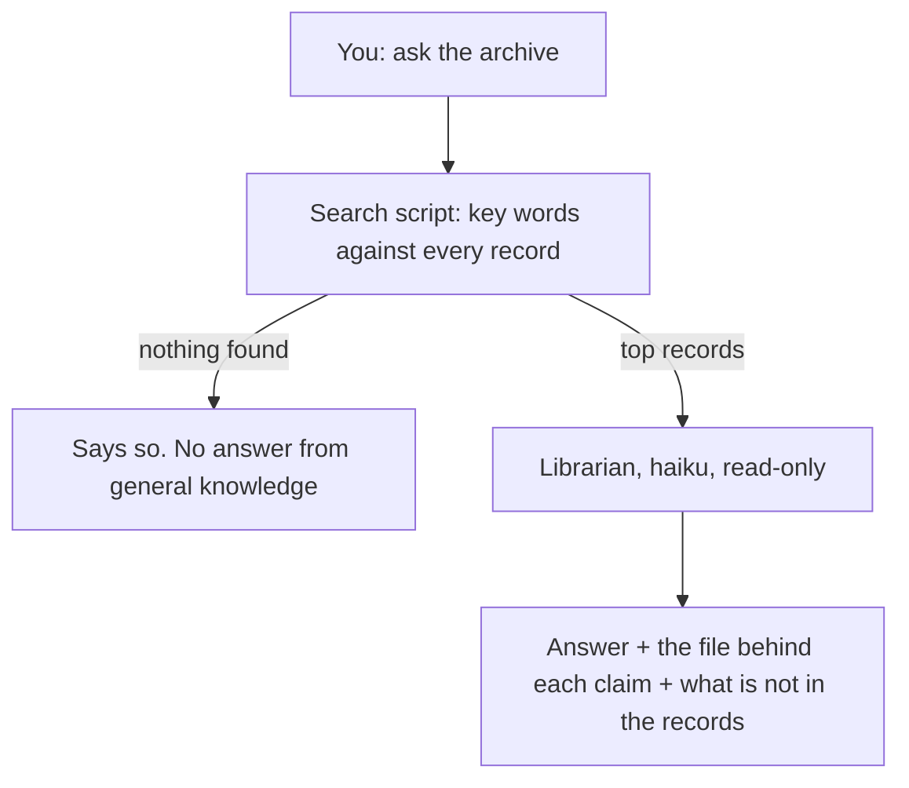

# The Archive: one memory for every plugin

Say **"ask the archive why we chose REST"** and Claude searches what your other plugins already wrote down in this project: Code Court verdicts, Bug ER charts, Critics' reviews, Army lessons, Mission Control rulings, Academy report cards. A librarian answers from those files and shows the path behind every claim.

It reads. It never moves, merges or edits a record.

## Install

```
/plugin install archive --marketplace omer-yehuda/plugins
```

On Claude Code versions earlier than 2.1.275, run `/plugin marketplace add omer-yehuda/plugins` first, then `/plugin install archive@omer-plugins`.

## Commands

| Say / run | What happens |
|---|---|
| `ask the archive <question>` · `/archive:recall <question>` | Searches the records and answers with sources |
| `/archive:timeline [plugin]` | Dated list of records, newest first (runs only when you type it) |
| `/archive:shelf` | Which folders are readable, and which were skipped and why |
| `/archive:catalog` | Writes the full index to `.archive/index.json` |

## What it reads

| Plugin | Folder | Record | Outcome shown |
|---|---|---|---|
| army | `.army/lessons.md`, `.army/recon.md` | Lessons learned, project recon | |
| court | `.court/cases/<id>/` | Case, briefs, verdict | The `Ruling:` line |
| er | `.er/charts/<id>/` | Bug chart | |
| critics | `.critics/tastings/<id>/` | Critic cards and review | The `Overall:` stars |
| customs | `.customs/reports/` | Inspection reports | |
| studio | `.studio/productions/<date>-<slug>/` | Research, script, metadata | rendered |
| atc | `.atc/airspace.json` | Live lanes (state, not history; left out of the timeline) | |
| mission-control | `.mission/countdowns/<id>/` | Facts, station reports, ruling | The `Ruling:` line |
| academy | `.academy/exams/<id>/` | Exam and results | The grade |
| newsroom | `.newsroom/editions/<id>/` | Wire and drafts | written |
| premiere | `.premiere/productions/<id>/` | Shot list and look | rendered |

Only `.md`, `.txt` and `.json` files are read, at most 20 per record.

## How it works



- **Search is a script.** Key words are matched against record titles, outcomes and text. No embeddings, no network, no index to keep in sync: every search scans the folders as they are.
- **The librarian cannot write.** It has Read, Glob and Grep only, and answers from the files it was given.
- **History, not orders.** A record says what was decided then. The archive reports it; it does not act on it or judge whether it still holds.

## Safety & privacy

- A plugin folder that is tracked in git, is a symlink, or points outside the project is skipped as planted and listed under `/archive:shelf`. A repository cannot plant a "past verdict" for the archive to repeat.
- Symlinks inside record folders are ignored.
- Records are treated as data. Instructions found in a record are quoted to you, not followed.
- Your question goes to the script through a file, never on a command line.
- There is no session hook. Nothing from the archive enters a session unless you ask for it.
- `.archive/` holds only the index, protected by its own `.gitignore` (`*`). Delete it any time.

## Limits

- It is key-word search. A question worded very differently from the record may need a second try.
- Each plugin's file layout is a contract. If a plugin changes where it writes, its entry in `scripts/shelves.js` must change too.

## Not affiliated

Not affiliated with or endorsed by Anthropic.

## Requirements

- Claude Code 2.1.275 or later
- Node.js 18+ (git is used only to detect tracked folders)
- Tests: `node --test plugins/archive/tests/*.test.js`
