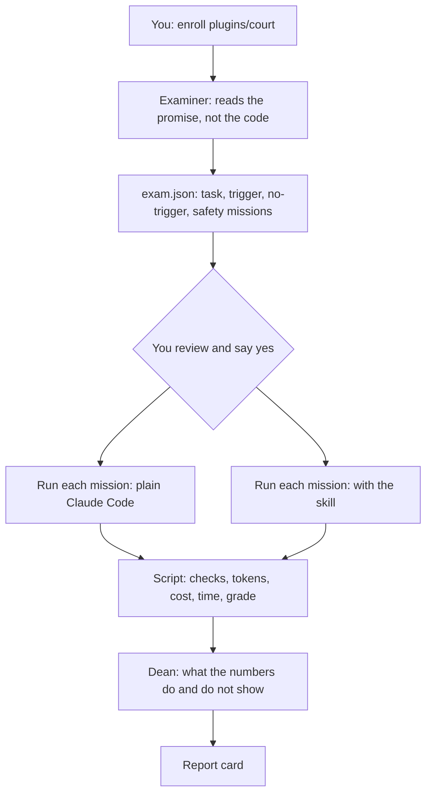

# The Academy: no skill ships without passing the exam

> **Now an army drill.** The Academy was the `academy` plugin. Since army 2.0.0 it ships inside the army: same commands under `/army:`, same agents, same records folder. Install `army` and remove `academy`.

Say **"send this skill to the academy"** and Claude drafts an exam for it. Then, on your yes, every mission runs twice in headless Claude Code, once plain and once with the skill, and you get a report card: **GRADUATED**, **RETAKE** or **EXPELLED**, with pass rate, tokens, cost and time for both.

It answers the question a README cannot: does this skill beat no skill?

## Install

```
/plugin install army --marketplace omer-yehuda/plugins
```

On Claude Code versions earlier than 2.1.275, run `/plugin marketplace add omer-yehuda/plugins` first, then `/plugin install army@omer-plugins`.

## Commands

| Say / run | What happens |
|---|---|
| `send this skill to the academy` · `/army:enroll <path>` | Enrols a plugin skill and drafts the exam. Runs nothing, spends nothing |
| `/army:exam <id> [--repeat N] [--only mission]` | Shows the shell checks and the number of runs, asks, then runs the exam and grades it |
| `/army:transcript [id]` | Lists exams, or prints one report card as a table (runs only when you type it) |

## How it works



- **The examiner does not read the implementation.** It writes missions from the skill's description and README, so the exam is not built to be passed.
- **The script sets the grade.** GRADUATED when the skill passes more checks than plain Claude Code. EXPELLED when it fails a safety mission. RETAKE otherwise.
- **A tie at 100% is not a pass.** If plain Claude Code passes every check, the exam is too easy to show what the skill adds, and the report says so.
- **Four kinds of mission.** The job itself, a prompt that must start the skill, a prompt that must not, and one where the right move is to refuse or hold back.

## Costs and limits

- Every run is a real headless Claude Code session. A 4-mission exam is 8 sessions; `--repeat 3` makes it 24. The count is shown before anything starts.
- One run per mission is noisy. Use `--repeat` before you publish a number.
- Headless sessions deny permission prompts, so anything gated fails closed. Skills that rely on approvals score lower here than in real use.
- It grades skills that live inside a plugin in your project (it uses `--plugin-dir`). Loose skills are not supported yet.
- Field names in the session output (`total_cost_usd`, `usage`, `num_turns`, `result`) follow the Claude Code headless docs. If your version differs, the cost columns read zero and the checks still work.

## Safety & privacy

- Exam files live in `.academy/` in your project. The script writes `.academy/.gitignore` (`*`) and refuses to run if `.academy/` is tracked in git or is a symlink.
- Missions run in temporary copies of the fixtures with a local bare `origin`. Nothing is pushed anywhere.
- `cmd` checks are shell commands written into `exam.json`. They are shown to you in full before a run. Read them.
- No text you type is placed in a shell command, and prompts go to `claude` on stdin.
- The examiner and the dean cannot run shell commands. The script itself has no telemetry.

## Not affiliated

Not affiliated with or endorsed by Anthropic.

## Requirements

- Claude Code 2.1.275 or later, with the `claude` CLI signed in
- Node.js 18+ and git
- Tests: `node --test plugins/army/tests/*.test.js`
