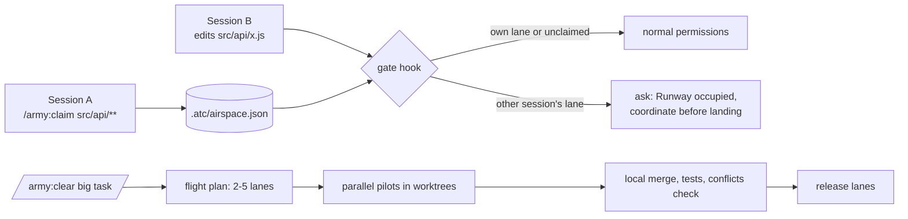

# ATC: air traffic control for parallel Claude Code sessions

> **Now an army drill.** ATC was the `atc` plugin. Since army 2.0.0 it ships inside the army: same commands under `/army:`, same agents, same records folder. Install `army` and remove `atc`.

**Many Claude Code sessions, one repo, fewer collisions.** Run several Claude Code sessions (or parallel subagents) on one repo with a check before one session edits a file another session has claimed.

Each session files a flight plan: the lanes (file globs) it will work in. The control tower watches the runway. If another session tries to land in an occupied lane, Claude Code stops and asks you first.

## Install

```
/plugin install army --marketplace omer-yehuda/plugins
```

On Claude Code versions earlier than 2.1.275, run `/plugin marketplace add omer-yehuda/plugins` first, then `/plugin install army@omer-plugins`.

## Commands

| Say / run | What happens |
|---|---|
| `/army:claim 'src/api/**' -- add pagination` | Registers lanes for this session under an auto callsign (for example `FALCON-7`). Warns and refuses on overlap unless you confirm. |
| `/army:release` | Frees this session's lanes. |
| `/army:radar` | ASCII board of live flights, lanes, ages and conflicts. |
| `ATC, clear for takeoff <task>` or `/army:clear <task>` | HQ splits a big task into 2-5 flights with non-overlapping lanes, shows the plan once (go / fewer flights / cancel), flies them as parallel `pilot` agents in worktrees, merges locally, runs tests and reports any file touched outside its lane. |

## How it works



- State is `.atc/airspace.json` at the git root. `.atc/.gitignore` contains `*`, and ATC refuses to run (and the gate ignores the airspace) if `.atc/` is tracked in git, because a committed airspace is untrusted.
- A flight is live only with a sane heartbeat (not in the future) and under 8 hours old, whatever its heartbeat says. Callsign and purpose shown in prompts are stripped of control characters (purpose capped at 80 characters).
- Purposes and globs reach the script through a JSON file (`--plan-file`), never through the shell.
- Writes are atomic (temp file + rename) behind a lock file, so concurrent sessions never corrupt it.
- A flight expires after 2 hours without a heartbeat (any gated edit by that session refreshes it). The `SessionEnd` hook releases lanes immediately.
- The gate only ever answers "ask". It never approves anything, so your normal permission rules still apply. On any internal error it exits silently and the tool call proceeds.
- Lane globs: `**` (any depth), `*`, `?`, `{a,b}`. A directory such as `src/api` covers everything under it.
- For `/army:clear`, flights are registered under synthetic ids owned by the HQ session, so pilots (same session id) pass the gate in their own lanes. Lane discipline between pilots is checked afterwards with `atc.js conflicts`, which lists files changed outside a flight's lanes and files two flights both touched.

## Safety & privacy

- Not affiliated with or endorsed by Anthropic.
- Local only: no network calls, no telemetry, no dependencies (Node built-ins).
- The only files ATC writes are inside `.atc/` (plus branches and merges you approve during `/army:clear`). It never pushes.
- `/army:clear` merges flight branches locally and never resolves a merge conflict silently.

## Honest limits

- **Coordination, not a sandbox.** The gate covers Claude's file tools (`Write`, `Edit`, `MultiEdit`, `NotebookEdit`). It does not see shell commands such as `sed -i`, `git checkout` or build tools that write files.
- It only protects sessions that run this plugin in the same checkout (worktrees of the same repo share one airspace). Sessions without the plugin, other editors and humans are not gated.
- "Ask" interrupts a session; it cannot stop one running in a mode that skips permission prompts.
- Overlap detection between two globs is conservative: it may warn about lanes that do not really collide, never the reverse for simple cases.
- Subagents are assumed to report the parent session's id to hooks. If your Claude Code version gives them their own id, claim their lanes with `/army:claim` from the pilot's brief or expect an "ask" on their edits.

## Requirements

- Claude Code with plugin support, Node 18+, git.
- Tests: `node --test plugins/army/tests/*.test.js`
