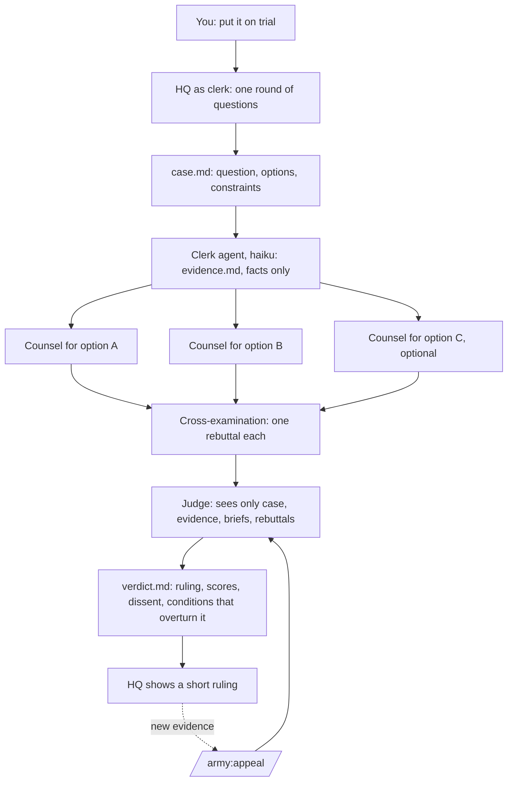

# Code Court: put any technical decision on trial

> **Now an army drill.** Code Court was the `court` plugin. Since army 2.0.0 it ships inside the army: same commands under `/army:`, same agents, same records folder. Install `army` and remove `court`.

Say **"put it on trial: should we move from REST to GraphQL?"** and Claude opens a courtroom. Each option gets its own counsel, a judge who never saw your opinion rules from the evidence, and the verdict tells you which facts would overturn it.

## Install

```
/plugin install army --marketplace omer-yehuda/plugins
```

On Claude Code versions earlier than 2.1.275, run `/plugin marketplace add omer-yehuda/plugins` first, then `/plugin install army@omer-plugins`.

## Commands

| Say / run | What happens |
|---|---|
| `put it on trial: <decision>` · `take this to court` · `/army:trial <decision>` | Full trial with 2 to 4 options. Add `--full` for opus counsel and judge |
| `/army:appeal <case-id> <new evidence>` | Reopens a case; the judge re-rules and shows what changed |
| `/army:docket` | Lists past cases and rulings (runs only when you type it) |

Example: `put it on trial: should we move from REST to GraphQL?`

## How it works



- **One side is not a trial.** A case needs at least two options and at most four. Add "keep the current approach" as a defendant if you only have one idea.
- **Claims need proof.** Every claim is tagged with an evidence entry, a source URL, or UNVERIFIED. The judge discards UNVERIFIED claims that matter.
- **The judge is independent.** It never receives HQ's opinion or your chat, only the case file. It has no web access, so it rules on the record.
- **Bounded cost.** One round of arguments and one rebuttal each. Lean mode uses sonnet (clerk: haiku); `--full` uses opus for counsel and judge.
- **The court advises, you decide.** It never implements the ruling.

## Safety & privacy

- Case files live in `.court/` in your project. The script writes `.court/.gitignore` (`*`) so they are never committed, and refuses to run if `.court/` is tracked in git (a repository could plant a fake verdict).
- Agents have least-privilege tools: the clerk, counsel and judge cannot run shell commands; the judge has no web access.
- Text found in files and web pages is treated as data, never as instructions. Agents never push, deploy, delete or install anything.
- No text you type is ever placed in a shell command: the decision and options go through a file, and ids are made and validated by the script. The script also refuses state folders that are symlinks.
- The script makes no network calls and has no telemetry. Counsel use web search for their own research.

## Not affiliated

Not affiliated with or endorsed by Anthropic.

## Requirements

- Claude Code 2.1.275 or later
- Node.js 18+ (for the helper script, no dependencies)
- Tests: `node --test plugins/army/tests/*.test.js`
