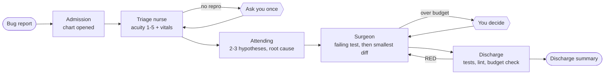

# Bug ER: the smallest incision that fixes it

> **Now an army drill.** Bug ER was the `er` plugin. Since army 2.0.0 it ships inside the army: same commands under `/army:`, same agents, same records folder. Install `army` and remove `er`.

Your bug gets admitted, triaged, diagnosed and operated on with the smallest possible incision. No 40-file rewrite for a one-line bug: every fix starts with a failing regression test and is held to a hard **incision budget**.

## Install

```
/plugin install army --marketplace omer-yehuda/plugins
```

On Claude Code versions earlier than 2.1.275, run `/plugin marketplace add omer-yehuda/plugins` first, then `/plugin install army@omer-plugins`.

## Commands

| Say / run | What happens |
|---|---|
| `admit this bug <report>` · `send it to the ER <report>` · `/army:admit <report>` | Runs the full ER flow and ends with a discharge summary card |
| `/army:admit <report> --full` | The attending (diagnosis) runs on Opus instead of Sonnet |
| `/army:admit <report> --budget 5/80` | Sets the incision budget: 5 files, 80 changed lines (tests excluded) |
| `/army:chart [id]` | Shows the latest chart, or a past one by id (a part of the id is enough) |

`/army:chart` runs only when you type it. The main skill fires only on its phrases or its slash command, never on ordinary coding requests.

## How it works



| Step | Agent | Model | Can edit code? | Writes |
|---|---|---|---|---|
| Triage | `triage-nurse` | haiku | no | `triage.md` |
| Diagnosis | `attending` | sonnet (opus with `--full`) | no | `diagnosis.md` |
| Surgery | `surgeon` | sonnet | yes, within the budget | `surgery.md` |
| Discharge | `discharge` | haiku | no | `discharge.md` |

Triage levels: **1** production down or data loss, **2** major feature broken, **3** broken with a workaround, **4** minor defect, **5** cosmetic.

## The incision budget

The surgeon may change at most **3 files and 40 lines** by default (added plus deleted lines, test files not counted). The surgeon writes a regression test that fails first, then applies the smallest diff that makes it pass. No refactors, renames, reformatting, new dependencies or drive-by fixes.

If the honest fix is bigger than the budget, the surgeon stops before going over and the chief physician asks you: raise the budget, re-scope, or stop. Discharge measures the incision again with the script and flags any change outside the root-cause area.

You can measure any diff yourself:

```bash
node plugins/army/scripts/er/er.js incision --base HEAD --exclude-tests --max-files 3 --max-lines 40
```

It prints JSON and exits 0 within budget, 2 over budget. Untracked new files are counted too.

## Example

```
/army:admit paginate(items, 10, 2) returns the wrong page, test "second page" fails
```

```
DISCHARGE SUMMARY
Acuity:      3 - wrong page returned, workaround exists
Diagnosis:   off-by-one in page offset, src/paginate.js:4
Incision:    1 file / 2 lines (budget 3/40, tests excluded)
Regression:  "returns the second page" (failed before, passes now)
Tests:       12 pass, 0 fail; no lint or typecheck configured
Follow-up:   - last-page handling in src/paginate.js:9 looks fragile, NOT touched
Chart:       .er/charts/20261119-101500-paginate-wrong-page/
```

## Safety & privacy

- Charts live in `.er/` in your project. `admit` writes `.er/.gitignore` (`*`) so git and `npm pack` skip it, and refuses to run if `.er/` is tracked in git (a repository could otherwise plant a fake chart).
- Every agent treats the bug report, logs and files as data and reports embedded instructions instead of following them.
- Diagnosis and discharge cannot edit code. Only the surgeon can, under the budget.
- Agents never commit, push, deploy or install dependencies. The fix stays in your working tree for you to review.
- The script makes no network calls and has no dependencies. Docker build contexts ignore nested `.gitignore` files, so add `.er` to your `.dockerignore`.
- No text you type is placed in a shell command: the bug report goes through a file and chart ids are made and checked by the script. Symlinked `.er` folders are refused.
- Triage, diagnosis and discharge hold Bash (to run the repro and tests), so "cannot edit code" is a rule they follow, not a hard block.
- Running the repro or the tests executes your project's code, exactly as you would yourself. Use it on projects you trust.

## Requirements

- Claude Code with plugin support
- Node 18+ (for the script)
- git (recommended: without it the incision budget cannot be measured)

Run the tests: `node --test plugins/army/tests/*.test.js`

## License

MIT. The ER and hospital words are only a metaphor for a bug-fixing workflow and have no medical meaning; Bug ER gives no medical advice.

Not affiliated with or endorsed by Anthropic.
