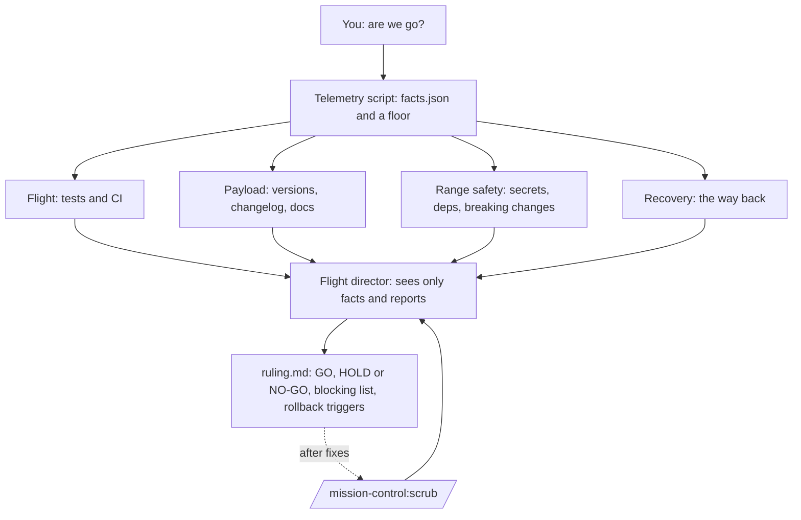

# Mission Control: go or no-go before every release

Say **"mission control, are we go?"** and Claude runs a launch poll. A script collects the release facts, four stations report, and a flight director who never saw your opinion rules **GO**, **HOLD** or **NO-GO**, with the blocking items and the signals to watch after launch.

It checks a release. It never performs one: no tag, no push, no deploy.

## Install

```
/plugin install mission-control --marketplace omer-yehuda/plugins
```

On Claude Code versions earlier than 2.1.275, run `/plugin marketplace add omer-yehuda/plugins` first, then `/plugin install mission-control@omer-plugins`.

## Commands

| Say / run | What happens |
|---|---|
| `mission control, are we go?` · `/mission-control:countdown [since-ref]` | Full poll since the given ref, or since the latest tag. Add `--full` for an opus flight director |
| `/mission-control:scrub <id>` | After fixes: re-polls the stations that said NO-GO and shows the ruling before and after |
| `/mission-control:log` | Lists past countdowns and rulings (runs only when you type it) |

## How it works



- **Facts first.** The script finds what needs no judgment: a manifest version that disagrees with its changelog or with the root README table, a changed unit with no changelog entry, uncommitted changes, a missing release base.
- **A floor, not a vote.** Those findings set the best possible ruling. The flight director can rule lower than the floor, never higher.
- **The director is independent.** It receives the facts and the four reports, not your chat and not CAPCOM's opinion.
- **Bounded cost.** Four small station agents and one director. Lean mode uses haiku and sonnet.

## What the script understands

A unit is a folder with a version manifest: the project root, `plugins/*` and `packages/*`. Manifests: `.claude-plugin/plugin.json`, `package.json`, `pyproject.toml`. The changelog is `CHANGELOG.md` in the same folder, and its first `## x.y.z` heading is the changelog version. Other layouts are not detected yet.

## Safety & privacy

- Countdown files live in `.mission/` in your project. The script writes `.mission/.gitignore` (`*`) and refuses to run if `.mission/` is tracked in git or is a symlink.
- Agents have least-privilege tools: stations and the director cannot run shell commands or edit your code.
- Text found in files and commit messages is treated as data, never as instructions.
- No text you type is placed in a shell command. Refs are validated and git is run without a shell.
- The script makes no network calls and has no telemetry of its own.

## Limits

- Stations read tests and CI files; they do not run them. Run your tests yourself, or let CI do it.
- A GO is advice from a checklist, not a guarantee.

## Not affiliated

Not affiliated with or endorsed by Anthropic.

## Requirements

- Claude Code 2.1.275 or later
- Node.js 18+ and git
- Tests: `node --test plugins/mission-control/tests/*.test.js`
