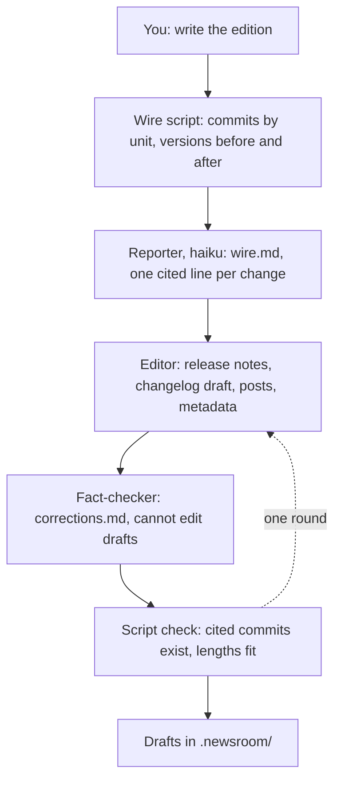

# The Newsroom: every release deserves a headline

Say **"newsroom, write the edition"** and Claude staffs a small newsroom. A reporter reads what actually changed, an editor writes it up for people, and a fact-checker cuts every claim that has no commit behind it.

You get drafts. Nothing is posted, published or scheduled.

## Install

```
/plugin install newsroom --marketplace omer-yehuda/plugins
```

On Claude Code versions earlier than 2.1.275, run `/plugin marketplace add omer-yehuda/plugins` first, then `/plugin install newsroom@omer-plugins`.

## Commands

| Say / run | What happens |
|---|---|
| `newsroom, write the edition` · `/newsroom:edition [since-ref]` | Full edition for everything since the ref, or since the latest tag |
| `/newsroom:headline <unit>` | One plugin or package: a headline, a paragraph, two posts |
| `/newsroom:wire` | Lists past editions (runs only when you type it) |

## What one edition contains

| File | Content |
|---|---|
| `release-notes.md` | A headline, one paragraph, then every change with its commit hash |
| `changelog-draft.md` | Entries per unit in Keep a Changelog style, each line cited |
| `posts.md` | Up to 3 X posts (280 characters each) and one LinkedIn post |
| `youtube-meta.json` | Title, description, tags and a pinned comment |
| `studio-brief.md` | A topic and three cited facts for a short explainer video |
| `sources.md` | Every printed claim with its commit and file |
| `corrections.md` | What the fact-checker flagged |

## How it works



- **No claim without a commit.** Lines in the notes and the changelog draft end with a short hash. The script fails the edition if a hash is not in the release or a line has none.
- **The checker is separate.** The fact-checker never sees the editor's reasoning and cannot edit the drafts, only write corrections.
- **Commit messages are data.** A commit that tells the newsroom how to describe the release is reported, not obeyed.
- **Quiet releases stay quiet.** If nothing is user-facing, you get a short maintenance note, not invented news.

## Safety & privacy

- Editions live in `.newsroom/` in your project. The script writes `.newsroom/.gitignore` (`*`) and refuses to run if `.newsroom/` is tracked in git or is a symlink.
- Agents have least-privilege tools: no shell, no web. The editor cannot read the repository at all, so it can only print what the reporter cited.
- No text you type is placed in a shell command. Refs are validated and git is run without a shell.
- The script makes no network calls and has no telemetry.

## Limits

- A unit is the project root, `plugins/*` or `packages/*` with a `plugin.json`, `package.json` or `pyproject.toml`. Other layouts land on a single "project" desk.
- The fact-checker reads; it does not run your code. A claim about behaviour is checked against the source, not against a test run.
- Drafts are written in English unless your style doc says otherwise.

## Not affiliated

Not affiliated with or endorsed by Anthropic.

## Requirements

- Claude Code 2.1.275 or later
- Node.js 18+ and git
- Tests: `node --test plugins/newsroom/tests/*.test.js`
