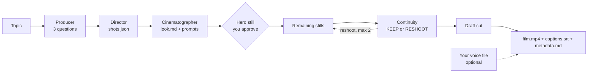

# Premiere: a film crew for realistic short films

Say **"premiere, make a film about the last lighthouse keeper"** and Claude staffs a crew. A director writes the shot list, a cinematographer writes one prompt per shot with a look that holds, you generate the stills with the image model you choose, continuity rejects the bad frames, and ffmpeg cuts a graded, scored film with slow camera moves.

Toon Shorts draws. Studio explains. Premiere films.

## Be clear about what this is

- **Premiere does not contain an image model.** Realistic pictures come from a model you choose and run. Premiere writes the prompts, checks the frames and makes the film.
- **Version 1 moves the camera, not the subject.** Each shot is one still with a slow push, pan or tilt. Generated video clips are planned, not shipped.
- **No voice synthesis.** Supply a voice file, or let the score and captions carry it.

## Install

```
/plugin install premiere --marketplace omer-yehuda/plugins
```

On Claude Code versions earlier than 2.1.275, run `/plugin marketplace add omer-yehuda/plugins` first, then `/plugin install premiere@omer-plugins`.

You need Node.js 18+ and ffmpeg on your PATH. Nothing else is installed.

## Commands

| Say / run | What happens | Uses an image model |
|---|---|---|
| `premiere, make a film about <topic>` · `/premiere:pitch <topic>` | Logline, look bible, shot list and `prompts.md` | No |
| `/premiere:director [id]` | Director pass on an existing production: size, angle and move of every shot, and how each shot leads into the next. Runs by itself inside every pitch | No |
| `/premiere:shoot <id>` | One still per shot, hero still first with your approval, then continuity review | Yes, yours |
| `/premiere:cut <id> [--draft]` | Renders `film.mp4`, `captions.srt`, `metadata.md` | No |
| `/premiere:dailies [id]` | Contact sheet, or the list of productions (runs only when you type it) | No |

## The crew

| Role | Who | Job |
|---|---|---|
| Producer | main session | Three questions, runs the crew, shows the pitch |
| Director | `director` agent (sonnet) | 5 to 8 shots: what is in frame, where the camera stands (`size`, `angle`), the move, the seconds, the line. `premiere.js shots` prints the camera plan with flow notes and the director fixes them before you see the pitch |
| Cinematographer | `cinematographer` agent (sonnet) | One character block and one world block, reused word for word in every prompt |
| Camera | the image model you choose | Makes the stills. Your own tool, or your signed-in browser |
| Continuity | `continuity` agent (sonnet) | Looks at every still: hands, faces, stray text, look drift. KEEP or RESHOOT |
| Editor, colorist, composer | `premiere.js` + ffmpeg | Camera moves, one grade, grain, cinema bars, score, captions |

## How it works



Everything lands in `.premiere/productions/<id>/` in your project.

## What the film looks like

- **Camera moves:** `push-in`, `pull-out`, `pan-left`, `pan-right`, `tilt-up`, `tilt-down`, `hold`. Slow and small, about 12% of the frame, rendered from a double-size frame so they stay smooth.
- **Grade:** `teal-amber`, `warm`, `cold`, `mono` or `none`. One grade for the whole film.
- **Texture:** film grain, a soft vignette, and 2.39:1 cinema bars on wide films.
- **Sound:** a low synthesized score made by ffmpeg itself, with no samples and no downloads. It ducks under your voice file. Loudness is normalised.
- **Size:** wide 1920x1080 or vertical 1080x1920, 30 fps. `--draft` renders at half size first.

The score is a plain drone. For a published film, replace it with music you have the rights to.

## Rules built into the crew

- Original, fictional, adult characters only. No real people, no existing characters, no studio or franchise names in prompts.
- No drawn words, logos or code in the images. Text belongs in the edit.
- Check the licence of the image model you use. Skip non-commercial models for published work.
- Declare AI-generated imagery when you upload, and say so if the voice is an AI voice. `metadata.md` reminds you.
- Premiere never uploads or publishes.

## Safety & privacy

- Productions live in `.premiere/` in your project. The script writes `.premiere/.gitignore` (`*`) and refuses to run if `.premiere/` is tracked in git or is a symlink.
- No text you type is placed in a shell command. ffmpeg is run with argument arrays, never through a shell.
- Still and voice file names must match a fixed pattern inside the production folder, so a shot list cannot point ffmpeg at other files.
- The script makes no network calls. Agents cannot run shell commands.
- In browser mode, every download needs your explicit yes, and a quota limit stops the shoot.

## Not affiliated

Not affiliated with or endorsed by Anthropic, or with any video editing product of a similar name.

## Requirements

- Claude Code 2.1.275 or later
- Node.js 18+ and ffmpeg
- Tests: `node --test plugins/premiere/tests/*.test.js` (render tests are skipped when ffmpeg is not installed)
