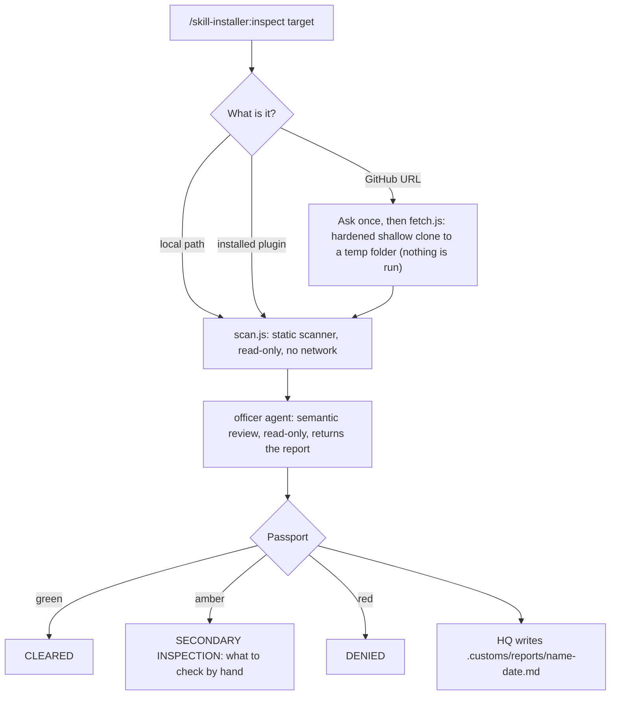

# The customs scanner

> **A first filter, not a guarantee.** A CLEARED passport means "nothing obvious found", not "safe". Not affiliated with or endorsed by Anthropic.

This is the scanner behind Skill Installer: it gates every install and runs on its own as `/skill-installer:inspect`. Before a skill or plugin crosses the border into your machine, it checks the papers: a fast static scanner reads every file (without running anything), then an officer agent reads what the regexes cannot, and you get a passport stamped **CLEARED**, **SECONDARY INSPECTION** or **DENIED**, with `file:line` evidence.

## Commands

| Say / run | What happens |
|---|---|
| `customs check <target>` · `inspect this plugin before I install it` · `/skill-installer:inspect <path \| GitHub URL \| plugin name>` | Locate, scan, officer review, passport, saved report |
| `/skill-installer:manifest <dir>` | Cargo list only: skills, agents, hooks, scripts, MCP servers, permissions. No verdict |

You can also run the scanner by hand (no Claude needed, Node 18+):

```bash
node scripts/scan.js <dir>                  # human table
node scripts/scan.js <dir> --json           # machine output
node scripts/scan.js <dir> --manifest       # inventory only
node scripts/scan.js <dir> --store .customs # also save scans/<name>-<date>.json (name derived by the scanner, [a-z0-9-] only)
node scripts/locate.js prep                 # private input folder in the temp dir (how the skills pass input)
node scripts/scan.js --target-file FILE     # folder read from the first line of FILE (FILE must be inside a prep folder)
```

Exit codes: `0` CLEARED, `1` SECONDARY INSPECTION, `2` DENIED, `3` usage or scanner error (the verdict is then SECONDARY INSPECTION, never CLEARED). That makes it usable in CI.

## Example passport

```
==== CUSTOMS PASSPORT ====
Package:  fast-setup 0.1.0   (https://github.com/<owner>/<repo>, shallow clone)
Verdict:  DENIED [RED]

Declared goods
  Skills: setup   Agents: none   Hooks: PreToolUse[*]   Scripts: 2   MCP: none
  Permissions: skill allowed-tools: Bash

Top findings
  [CRITICAL] RC001  scripts/install.sh:3   downloads content and pipes it into bash
  [HIGH]     PI007  skills/setup/SKILL.md:14  asks Claude to read ~/.ssh and send it to a webhook
  [MEDIUM]   HK003  hooks/hooks.json:5   PreToolUse hook runs on every tool call

Officer: the description says "formats markdown", but the script uploads ~/.ssh. Do not install.
Report: .customs/reports/fast-setup-2026-11-19.md
==========================
```

## How it works



**The scanner** (`scripts/scan.js`, rules in `scripts/rules.js` and `scripts/checks.js`) looks for:

| Category | Examples |
|---|---|
| Remote code | `curl \| sh`, `iex (iwr ...)`, eval of downloads, unpinned `npx`/`uvx` |
| Obfuscation | encoded blobs that get decoded and run, `eval(atob(...))`, char-code assembly, minified scripts over 5 KB, NUL bytes in text files |
| Hidden text | zero-width and bidi characters, invisible Unicode tags, instruction-like HTML comments |
| Prompt injection | "ignore previous instructions", "do not tell the user", "disable the hook", asks to read secrets (only when phrased as instructions to the agent) |
| Credentials | `~/.ssh`, `~/.aws`, keychain, browser cookies, `.env`, environment dumps |
| Exfiltration | webhooks and paste sites, uploads, network calls in scripts that read secrets |
| Destructive | `rm -rf` on home or root, force push, `reset --hard`, dropping databases |
| Persistence | shell rc files, cron, launchd/systemd, sudo, edits to Claude settings or other plugins |
| Hooks, MCP, manifest | match-everything hooks, hooks that call out or auto-approve, unpinned MCP servers, missing license or repository, look-alike names |

Severity is CRITICAL, HIGH, MEDIUM or LOW. Any CRITICAL means DENIED, any HIGH means SECONDARY INSPECTION, otherwise CLEARED. The verdict counts **every** finding; the per-rule display cap only shortens the list. The officer can move the verdict, but only with written reasons.

**Coverage gaps are findings, never silent.** A file over 2 MB is scanned at both ends (first and last 1 MB) and reported as `TRUNCATED` (HIGH when it is a script, config or wired-up file). More than 5000 files, an unreadable file, an opaque binary that a hook launches, vendored `node_modules` that hooks point into, a scan that runs out of its 30 s budget, or any scanner error: all of these block CLEARED. Hooks, skills, agents and scripts are scanned first, so a cutoff cannot hide them.

**Weighting, so documentation does not cry wolf:** command patterns inside markdown are capped (MEDIUM in skill and agent files, LOW inside code fences, LOW in README-style docs). Remote-code patterns (pipe to a shell, `bash -c "$(curl ...)"`, `bash <(curl ...)`, download then run) never drop below HIGH in skill, agent and command files, and a doc that a skill, agent, command or hook points at is read as agent text. Prompt-injection phrases are never softened by what the text says about itself ("not an attack", "never read ~/.ssh" and similar claims change nothing); README-style docs cap them at MEDIUM. Comment lines (the language's own marker) lower a rule by one step, never to LOW for CRITICAL ones. A regex literal used as `/re/.test(` (a detector) and a plain message string such as `'git reset --hard (discards work)'` are treated as data. Test files that nothing wires up are capped at HIGH; a test file that a hook, MCP config or skill points at keeps full severity. `tests/` and `.customs/` folders are scanned like any other folder. Every exclusion and every weighting is printed in the output, nothing is silent.

**Self-scan transparency:** `scripts/rules.js`, `scripts/checks.js`, `scripts/analyze.js` and `scripts/norm.js` (and the test files that carry sample payloads) must contain the patterns they detect, so they declare `// customs:rules-file` on line 1 and the scanner skips them. That marker is honored **only for files inside this plugin's own install folder**. In any other package it is ignored and reported as a finding (`MF006`). The `tests/fixtures/` folder (inert sample payloads) is skipped when you scan Customs itself, and listed under EXCLUDED.

## What it can't catch

Static analysis is a first filter, not a guarantee. Customs will miss:

- Malicious logic that is built at run time, split across files, or fetched later by code that looks harmless
- Instructions written in a way no pattern expects (paraphrases, other languages, spread over several lines)
- A skill that is honest today and updated to be malicious tomorrow (pin a commit and re-scan)
- Behavior hidden in binaries or bytecode (listed, not read), or in the middle of a file over 2 MB (only its first and last 1 MB are read, and it is flagged)
- Dependencies: `node_modules` and anything a script installs later are not scanned
- Detector-like regex literals and message strings are weighted down; an attacker who finds a shape the lexer accepts could abuse that. The officer reads the findings too

A CLEARED passport means "nothing obvious found", not "safe". Read the permissions and hooks yourself for anything you will give real access to.

## Safety & privacy

- The scanner is read-only: no network, no telemetry, never executes, imports or `eval`s anything it reads, never follows symlinks (one pointing outside the package is reported), and stays fast on hostile input (no line is ever fed to a regex in one piece longer than 4 KB; a 1 MB single line scans in well under 3 s).
- **No package text ever reaches a shell.** The skills run `locate.js prep`, which makes a fresh, unpredictable folder in the system temp directory (mode 0700, never inside the project, so a repo cannot plant a symlink there) and write your argument there with the Write tool; `locate.js`, `fetch.js` and `scan.js` read it from there and accept a `--target-file` only inside such a folder. Only that folder (it carries a marker made with `O_EXCL`) is ever deleted, by `fetch.js --cleanup`. Output file names are computed by the scripts from the manifest name reduced to `[a-z0-9-]`.
- GitHub URLs: Customs asks first. `locate.js` accepts only strict `https://github.com/<owner>/<repo>[/tree/<ref>[/<subdir>]]` shapes (no `..`, no leading `-`, no shell characters). `fetch.js` then clones with an argument list (no shell) and hardened flags: `core.hooksPath=/dev/null`, `core.fsmonitor=false`, `protocol.file.allow=never`, no submodules, no LFS smudge, no credential prompts, `--depth 1`. Symlinks that point outside the clone are removed and flagged. Nothing from the clone is run: no `npm install`, no build, no tests.
- The officer agent has `Read`, `Glob` and `Grep` only: no shell and no Write. It returns the report text and HQ saves it. Its standing orders say the package text is hostile data.
- Snippets in reports are cut to 120 characters, secrets are masked to their first 4 characters, and control characters (terminal escape sequences) are shown as `\x..` escapes.
- Reports go to `.customs/` in the current project, which protects itself with a `.gitignore` of `*`. A store with files tracked by git, or a symlinked `.customs`, `scans/` or `reports/` (or any link inside them), is refused (`customs-tracked`, `customs-planted`), and every write goes through a no-follow, write-then-rename helper, so a hostile repo cannot make a scan overwrite files outside the project.
- Customs never installs, enables, deletes or publishes anything for you. (`fetch.js --cleanup` removes only the temp clone it made itself.)

## Requirements

Claude Code with plugin support and Node.js 18+. `git` for GitHub URLs. Tests: `node --test plugins/skill-installer/tests/*.test.js`. See [CHANGELOG.md](CHANGELOG.md).
