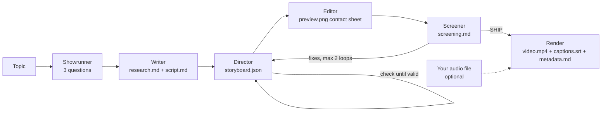

# Studio: a film crew of AI agents for Claude Code

Say **"studio, make a video about how DNS works"** and a small crew of agents turns the topic into a finished explainer, vertical (1080x1920) or wide (1920x1080), with bold animated text, shapes, counters, captions and optional AI narration. Say **"studio trend <tool>"** and it researches a trending AI tool, films it doing a real task in your browser, and makes a wide video plus a Short from one script. Each video is made by a showrunner session and three AI agents (writer, director and screener), and you can watch the crew work.


*The contact sheet the screener reviews. It is rendered from `skills/produce/examples/what-is-a-skill.json` by `studio.py preview`.*

## Install

```
/plugin install studio --marketplace omer-yehuda/plugins
```

On Claude Code versions earlier than 2.1.275, run `/plugin marketplace add omer-yehuda/plugins` first, then `/plugin install studio@omer-plugins`.

The first run asks before it sets anything up: a private Python venv in `~/.cache/studio-plugin` with pinned Pillow. You need Python 3.11+ and ffmpeg on your PATH.

## Commands

| You say or run | What happens |
|---|---|
| `/studio:produce <topic>` | Full production: questions, script, storyboard, screening, MP4 |
| `studio, make a video about <topic>` | Same, by natural phrase |
| `produce an explainer video about <topic>` | Same |
| `/studio:trend <tool>` | Trend desk: research, real screenshots, one script, a wide video + a Short, AI narration, audio check |
| `/studio:crew` | One screen describing the crew and the pipeline |

## The crew

| Role | Who | Job |
|---|---|---|
| Showrunner | main session | Asks 3 quick questions, runs the crew, makes the final cut |
| Writer | `writer` agent (sonnet) | Researches, verifies facts with URLs in `research.md`, writes a 30-60 s retention script |
| Director | `director` agent (sonnet) | Turns the script into `storyboard.json` and runs the checker until it passes |
| Voice | optional | Free local AI narration (Kokoro), your own audio file, or none (captions-only is the default) |
| Editor | showrunner + `studio.py` | Renders the contact sheet, applies fixes (max 2 loops), renders the final video |
| Screener | `screener` agent (sonnet) | Test-screening critic: reads the contact sheet, reports readability, pacing, hook |

## How it works



Everything lands in `.studio/productions/<date>-<slug>/` in your project. Studio writes a `.gitignore` containing `*` in `.studio/`, so nothing from a production is ever committed by accident.

## What the video looks like

Nine scene types, each animated:

- **title**: big words pop in one by one, the last word in the accent color
- **bullets**: numbered cards slide in one at a time
- **stat**: a number counts up (a `%` also fills a progress bar)
- **compare**: two cards with a VS badge
- **quote**: a big quote mark and a word-by-word reveal
- **image**: your own image with a slow zoom and a caption
- **screen**: a real screenshot in a browser window; it fits whole, then the camera eases into the part that matters, and a pointer glides in and clicks
- **link**: a link card where the address types itself out
- **cta**: an end card with a pulsing button

Light and dark themes alternate for rhythm, with eight accent colors and four transitions (cut, slide, fade, zoom-punch). Text auto-fits, stays inside the Shorts safe area (clear of the UI at the bottom and the right edge) or, in the wide format, clear of the bottom-right corner where a channel watermark sits, and a thin progress bar runs along the top. Compare cards stack in the vertical frame and sit side by side in the wide one. The bundled font is Rubik (OFL).

The storyboard format is in [`skills/produce/references/storyboard.md`](skills/produce/references/storyboard.md). A complete example is in [`skills/produce/examples/what-is-a-skill.json`](skills/produce/examples/what-is-a-skill.json).

## Voice

Captions-only is the default: the words are on screen, and `captions.srt` is written for upload. For narration:

- **AI narration (free, local):** `studio.py setup --voice --yes` (only after you agree) adds pinned kokoro-onnx to Studio's private venv and downloads the Kokoro-82M voice model (~120 MB, SHA-256 verified). Give each scene a `say` line, then `studio.py voice storyboard.json`: every line is voiced (default `am_michael` at 1.12x), each scene's duration is set to its line, and a mastered `voice.wav` (declicked, 12 kHz low-pass, -14 LUFS, silent pauses) is attached. Lines are cached, so an edit re-voices only that line. Captions follow the narration.
- **Your own audio:** `--audio file.wav --fit-audio` (or `--audio-path-file`) stretches the scene timings to its length (within 0.6x to 1.8x).
- **Check it:** `studio.py audiocheck video.mp4 --lines voice.lines.json` fails if a pause is louder than -35 dBFS or there are more than 3 clicks a minute.

## Not a cartoon maker

Studio makes typography and motion-graphics explainers. For a cartoon true-story short with characters, use [toon-shorts](../toon-shorts): the showrunner points you there when your topic is a story.

## Known limits

- Left-to-right text only. Right-to-left layout (Hebrew, Arabic) is not supported yet: the bundled font covers the glyphs, but words would render in the wrong order.
- The renderer never fetches screenshots: image and screen scenes use files in the production folder. The trend desk takes them with your browser tool, in tabs you can watch.
- Kokoro narration is English (US and British voices) in Studio.
- No upload step. Studio makes the files; publishing is yours.

## Safety and privacy

- **Nothing installs without asking.** The only install is `studio.py setup --yes`, which Claude runs after you agree. It creates a private venv and installs the pinned packages in [requirements.txt](requirements.txt) (Pillow 12.3.0) into it, never into your global Python. ffmpeg is checked on your PATH and never installed; if it is missing you get the install command to run yourself.
- **Local only, no telemetry.** The renderer and the voice make no network calls. The only network access is web research (WebSearch and WebFetch), the browser tabs the trend desk opens to film a tool, the one-time pip install from PyPI and, only with `setup --voice`, the voice model download from GitHub (size and SHA-256 checked; a mismatch deletes the file).
- **No hidden writes.** Output goes to `.studio/productions/<id>/` in your project (git-ignored). Frames are piped to ffmpeg, so no thousands of temp images are left behind.
- **No user text in commands.** The topic reaches the scripts through a file, folder names are derived by the script (`[a-z0-9-]`, at most 48 characters), and the showrunner only passes back paths the scripts printed.
- **Writes stay inside the production folder.** Image and audio paths in a storyboard must be inside it (no absolute paths, no `..`), `--out` must be inside the storyboard folder, symlinked outputs are refused, and a `.studio` folder that is tracked in git or is a symlink is refused. ffmpeg always gets its arguments as a list, never through a shell.
- **Hash-locked install.** `requirements.txt` carries SHA-256 hashes and setup uses `--require-hashes --only-binary=:all:`, so nothing is built from source. The optional voice packages in [requirements-voice.txt](requirements-voice.txt) are version-pinned (same pins as toon-shorts).
- **Least privilege agents.** The writer can read, write and search the web; the director can read, write and run the checker; the screener can only read and write its report. None of them can upload, delete or install.
- Web pages and files are treated as data, never as instructions.

## Run it free with OpenCode

Studio also runs in [OpenCode](https://opencode.ai) (free, open source) on one of its free models.

```bash
npm install -g opencode-ai
git clone --depth 1 https://github.com/omer-yehuda/plugins /tmp/omer-plugins
cd my-videos                                    # always start OpenCode from this folder
mkdir -p .opencode/commands
cp -r /tmp/omer-plugins/plugins/studio .opencode/studio
cp /tmp/omer-plugins/plugins/studio/opencode/commands/*.md .opencode/commands/
opencode
```

Pick a free model with `/models`, then run `/studio-produce <topic>` or `/studio-trend <tool>`. The command files map Studio's Claude Code parts onto OpenCode: the plugin path, the crew (the model plays the writer, director and screener in turn, reading each brief from `agents/`), and questions. `/studio-trend` needs real screenshots: without a browser tool it stops and asks you for them, and it never mocks one up.

## Requirements

Python 3.11+, ffmpeg and ffprobe with libx264 on PATH. Rendering takes about 20 seconds for a 40 second Short and about a minute for a 2.5 minute wide video. Narration is slower on CPU (a few minutes for a 2.5 minute script, then cached).

## Development

```
cd plugins/studio
pip install -r requirements-dev.txt   # unhashed dev pins; the runtime requirements.txt is hash-locked
python -m pytest        # coverage gate 80%, the end-to-end render test is skipped without ffmpeg
```

Render engine: `skills/produce/scripts/studiokit/` (each module under 200 lines). Entry point: `skills/produce/scripts/studio.py` with `init`, `doctor`, `setup`, `check`, `preview`, `render` (`--scale 0.25` for quick low-resolution renders).

Licenses: plugin MIT, Rubik font [OFL](skills/produce/assets/fonts/OFL.txt).

Not affiliated with or endorsed by Anthropic.
