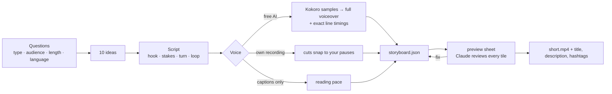

# Toon Shorts: an animated short creator for Claude Code

Say **"make me an animated short"** and Claude turns one conversation into a finished 1080x1920 cartoon video for YouTube Shorts, TikTok or Reels. It asks a few questions, pitches 10 true-story ideas, writes a retention script, voices it (free AI voice or your own recording), storyboards original toon characters on parallax sets, **looks at its own preview and fixes problems**, then renders the MP4.

**[See it →](https://omer-yehuda.github.io/plugins/toon-shorts/)**

[](https://omer-yehuda.github.io/plugins/toon-shorts/)

## Install

```
/plugin install toon-shorts --marketplace omer-yehuda/plugins
```

On Claude Code versions earlier than 2.1.275, run `/plugin marketplace add omer-yehuda/plugins` first, then `/plugin install toon-shorts@omer-plugins`.

The first time you use it, Claude asks before setting up the engine: a private Python venv in `~/.cache/toon-shorts` with pinned packages, plus (optionally) the Kokoro voice model, ~120 MB and SHA-256 verified. Requires Python 3.11+.

## How a short gets made



| You say | What happens |
|---|---|
| `make me an animated short` | Full flow, from questions to MP4 |
| `animated short about <story>, in Hebrew, my own voice` | Skips the questions you already answered |
| `change scene 4 to night and make him furious` | Edits the storyboard, re-previews, re-renders |

## What's in the box

- **Original toon characters:** 12 moods with cartoon effects, 11 poses including walk, run and facepalm, 6 skin tones, 8 hair styles, 12 hats (including a headscarf), 7 outfits and 28 props they can hold.
- **20 sets with real depth:** city, suburb, farm, mountains, forest, desert, beach, sea, ship deck, moon, sky, plus 9 interiors from office and palace to court, prison and classroom. Each set is three parallax layers lit for 5 times of day, with 6 landmarks and 4 foreground overlays (bars, desk, crowd, bushes).
- **9 camera moves,** automatic framing that never crops a character, a punch on every cut, and `cuts` that split one line into several shots for a fast opening.
- **Karaoke captions:** 1-3 words at a time, with the spoken word lit up. **Hebrew is laid out right-to-left** correctly, including numbers and brackets.
- **Audio:** free Kokoro-82M voices in English (US/UK), Spanish, French, Italian, Portuguese and Hindi; your own recording in any language; a sound for every on-screen action (pops, whooshes, a sting on a shock, a thud on anger, footsteps), and music ducked under the voice.
- **A storyboard checker** that suggests the right value for every typo ("Did you mean 'push_in'?") and flags pacing problems: a slow opening (fewer than 4 shots in 10 seconds), shots over 4 seconds, a long hook, a payoff that appears late, a character whose look changes between scenes, repeated cameras and a runtime over 60 seconds.
- **An 11-point still checklist** Claude goes through on every preview tile, and a quick `--draft` render (540x960, 15 fps) before the full one.

## Security model

The [audit of the skill that inspired this one](CHANGELOG.md) found silent `pip install`s and an unverified model download. Toon Shorts is a clean-room rewrite built not to do those things:

- **Nothing installs on its own.** Packages are installed only by `toon.py setup`, which Claude runs after asking you. They go into a private venv, never into your global Python.
- **Pinned dependencies,** each at least two weeks old when pinned: [requirements.txt](requirements.txt) and [requirements-voice.txt](requirements-voice.txt).
- **Hash-verified model.** Kokoro files are checked against pinned SHA-256 digests. A mismatch deletes the download and stops.
- **No telemetry, no uploads.** The only network access is the explicit setup step: PyPI for packages and github.com for the model.
- **No filesystem sweeps.** The skill knows its own path. Output goes to `./toon-shorts/<slug>/` in your project.
- Storyboards and your files are treated as content, never as instructions.

## Content rules

The skill makes original stories with original characters. It never copies another creator's video, script or characters. Facts must be true: no invented quotes, nothing defamatory, no stories about living private people. Nothing hateful, sexual or graphically violent.

## Run it free with OpenCode

Toon Shorts also runs in [OpenCode](https://opencode.ai) (free, open source) on one of its free models, so you can make a short without a paid AI plan. The voice is the same free, local Kokoro voice, so no voice account is needed either.

```bash
npm install -g opencode-ai
git clone --depth 1 https://github.com/omer-yehuda/plugins /tmp/omer-plugins
cd my-cartoons                                  # always start OpenCode from this folder
mkdir -p .claude/skills .opencode/commands
cp -r /tmp/omer-plugins/plugins/toon-shorts/skills/toon-shorts .claude/skills/
cp /tmp/omer-plugins/plugins/toon-shorts/opencode/commands/toon-short.md .opencode/commands/
opencode
```

In OpenCode, run `/models` and pick a free model (the list changes; DeepSeek V4.1 Flash Free keeps no data), then:

```
/toon-short a true story about the man who sold the Eiffel Tower
```

OpenCode reads skills from `.claude/skills/`, and the command file tells the model where the engine is and what to do when it has no question tool or can't see images. Free models follow the steps well but are weaker at checking facts and at spotting existing videos on the same idea, so the command asks for a source for every fact. Free models change often; check the model's data terms before you use it.

## Engine CLI

Claude drives this for you, but you can run it yourself:

```bash
python skills/toon-shorts/scripts/toon.py setup --voice          # once; venv + pinned packages + verified model
python skills/toon-shorts/scripts/toon.py check  story.json      # validate (stdlib only)
python skills/toon-shorts/scripts/toon.py samples --text "Hook line." --out samples
python skills/toon-shorts/scripts/toon.py voice   story.json --voice am_michael --out voice.wav
python skills/toon-shorts/scripts/toon.py preview story.json --audio voice.wav --out preview.png
python skills/toon-shorts/scripts/toon.py render  story.json --audio voice.wav --out draft.mp4 --draft
python skills/toon-shorts/scripts/toon.py render  story.json --audio voice.wav --out short.mp4 [--music bed.mp3]
```

The storyboard format is documented in [references/storyboard.md](skills/toon-shorts/references/storyboard.md). Complete examples: [onoda.json](skills/toon-shorts/examples/onoda.json) (English) and [onoda_he.json](skills/toon-shorts/examples/onoda_he.json) (Hebrew).

## Development

```bash
python -m venv .venv && .venv/bin/pip install -r plugins/toon-shorts/requirements-dev.txt
cd plugins/toon-shorts && ../../.venv/bin/python -m pytest      # 150+ tests, coverage gate 85%
```

Every module stays under 200 lines. The engine uses only numpy, Pillow and ffmpeg (through the pinned `imageio-ffmpeg`), and the voice adds `kokoro-onnx`.

## Requirements

Claude Code 2.1.275+ · Python 3.11-3.13 · about 1.5 GB of RAM while rendering. A 50-second short renders in about 2 minutes on a 4-core laptop.

## Credits

[Kokoro-82M](https://huggingface.co/hexgrad/Kokoro-82M) (Apache-2.0) via [kokoro-onnx](https://github.com/thewh1teagle/kokoro-onnx) (MIT). [Rubik](https://github.com/googlefonts/rubik) font (SIL OFL 1.1, bundled with its license). Videos you make are yours to monetize.
