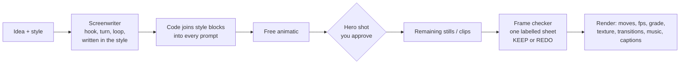

# Video Creator: one command per style

```
/video-creator:minecraft a village that rebuilds itself every morning
/video-creator:3d-realistic the last train through a frozen forest
/video-creator:anime a courier who races the sunrise
/video-creator:mix noir+cyberpunk a detective who never sleeps
```

Pick a look, give an idea, get a planned, styled, captioned video. Every style changes the whole pipeline, not just a prompt word: what the characters look like, the vocabulary of each shot, how the camera moves, the frame rate, the transitions, the colour grade, the texture and the music.

## What makes it different

| | Typical "AI video" skill | Video Creator |
|---|---|---|
| Styles | One prompt prefix | 14 full style packs, each with its own look, motion, fps, grade, texture, transitions and music bed |
| New looks | Edit the prompt | `mix` any two styles, `restyle` a finished story, or save your own with `new-style` |
| Consistency | Hope the model repeats itself | Style, character and world blocks joined into every prompt by code, word for word |
| Before spending credits | Nothing to watch | A free animatic with the real timing, moves, captions and music, in about 5 seconds |
| Media | One kind | Stills and video clips mixed freely; a short clip is held on its last frame |
| Quality gate | None | Hero gate plus a frame checker: style match, same character, stray text, hands, look-alikes |
| Platforms | One size | Shorts/TikTok/Reels 9:16, YouTube 16:9, square 1:1, feed 4:5 |

## Install

```
/plugin install video-creator --marketplace omer-yehuda/plugins
```

On older Claude Code versions run `/plugin marketplace add omer-yehuda/plugins` first, then `/plugin install video-creator@omer-plugins`. You need Node.js 18+ and ffmpeg. Nothing else is installed.

## The styles

| Command | Look | Edit |
|---|---|---|
| `/video-creator:minecraft` | Blocky voxel world, cube trees, pixel textures (a fan style; prompts never name the game) | pixelize transitions, chiptune |
| `/video-creator:3d-realistic` | Photoreal CGI, ray-traced light, anamorphic lens | teal-amber grade, grain, cinematic bed |
| `/video-creator:3d-cartoon` | Big-eyed family-feature 3D animation | warm grade, smooth slides, playful bed |
| `/video-creator:anime` | Cel shading, painted skies, speed lines | 24 fps, white flashes, anthem |
| `/video-creator:claymation` | Plasticine puppets on a miniature set | 12 fps stop-motion, jitter |
| `/video-creator:pixel-art` | 16-bit sprites and parallax | 12 fps, pixelate, scanlines, chiptune |
| `/video-creator:low-poly` | Faceted flat-shaded diorama | pastel grade, circle wipes |
| `/video-creator:comic` | Ink, halftone, bold angles | posterize, fast wipes, action bed |
| `/video-creator:watercolor` | Storybook washes on paper | slow dissolves, lullaby |
| `/video-creator:cyberpunk` | Neon rain, chrome, night city | glitch, scanlines, synthwave |
| `/video-creator:paper-cutout` | Layered craft paper, pop-up book | 15 fps, slides, jitter |
| `/video-creator:documentary` | Natural light, telephoto, candid | handheld camera, ambient bed |
| `/video-creator:noir` | 1940s black and white, blind shadows | mono, cinema bars, noir bed |
| `/video-creator:horror` | Found footage, night-vision green | heavy grain, handheld, dread |

Your own styles work everywhere: `/video-creator:make <your-style> <idea>`, and in mixes.

## All commands

| Command | What it does | Spends credits |
|---|---|---|
| `/video-creator:<style> <idea>` | Plan + prompts + animatic in that style | No |
| `/video-creator:make <style> <idea>` | The same, for any style id, a mix, or a custom style | No |
| `/video-creator:mix a+b <idea>` | Two styles at once: the world of `a`, the technique of `b` | No |
| `/video-creator:restyle <id> <style>` | Same story and timing, new look, new project | No |
| `/video-creator:new-style <description>` | Design and save your own style pack | No |
| `/video-creator:shoot <id>` | Get one image or clip per shot from your model, hero gate, frame check | Yes, on your model |
| `/video-creator:render <id> [--draft] [--burn] [--animatic]` | The styled cut: `video.mp4`, `captions.srt`, `metadata.md` | No |
| `/video-creator:styles` | List every style | No |

All of these are typed commands. You can also just ask: "video creator, make an anime video about ..." or "video creator, render 003-the-cube-village" goes through `make`, which picks the right step.

Flags on any style command: `--shorts` (default), `--youtube`, `--square`, `--feed`, `--seconds 15|30|60`.

## How it works



Under the hood the helper (`scripts/vc.js`) does the work in a few calls: `init` opens the project, `build` checks it, writes `prompts.md` and renders the animatic, `sheet` makes the labelled contact sheet, and `render` cuts the video.

Everything lands in `.video-creator/projects/<id>/` in your project: `project.json`, `style.json`, `prompts.md`, `media/`, `animatic.mp4`, `draft.mp4`, `video.mp4`, `captions.srt`, `metadata.md`.

## Built to be cheap on tokens

- **About 230 tokens per session** while installed: only one skill (`make`) and three agents describe themselves to the model. The 20 typed commands cost nothing until you type them.
- **One writer agent** per new video, reading files instead of long pasted briefs.
- **One helper call** (`build`) checks the plan, writes the prompts and renders the animatic; helper output is one line of JSON.
- **One image** for the frame check: a labelled contact sheet, with full-size images opened only when needed.
- **Re-renders reuse unchanged shots**, so fixing one shot does not re-encode the whole video.

Run `node tools/token-budget.js` in this repository to see what every plugin costs.

## Be clear about what this is

- **No image or video model is bundled.** You choose the model (any image tool, an image-to-video tool, a connected generator, or your signed-in browser). Video Creator plans, writes the prompts, checks the frames and cuts the video.
- **Stills get camera moves; clips play as they are.** Make the still first, approve it, then feed it to an image-to-video model with the shot's video prompt for real motion.
- **No voice synthesis.** Add a voice file, or let the captions and the music bed carry it.

## Rules built into the crew

- Original characters only. No real people, no existing characters, and no game, studio or franchise names in prompts, even for styles named after a look.
- No words or logos in images. Text belongs in the captions.
- Check your model's licence; skip non-commercial models for published work. Declare AI-generated content when you upload (`metadata.md` reminds you).
- Video Creator never uploads or publishes.

## Safety & privacy

- Projects live in `.video-creator/` with its own `.gitignore` (`*`). The script refuses a state folder that is tracked in git or is a symlink.
- No text you type is placed in a shell command; free text goes through a temp file made by `prep`. ffmpeg runs with argument arrays, never through a shell, inside the project folder, on file names derived from validated shot ids.
- The script makes no network calls. Agents cannot run shell commands.

## Not affiliated

Not affiliated with or endorsed by Anthropic, Mojang, Microsoft or any studio whose look a style resembles. Style names describe a look; the prompts describe it in plain words.

## Development

- Edit `styles/styles.json`, then run `node plugins/video-creator/scripts/gen-skills.js` to regenerate the style commands (CI runs it with `--check`).
- Tests: `node --test plugins/video-creator/tests/*.test.js` (render tests are skipped without ffmpeg).
